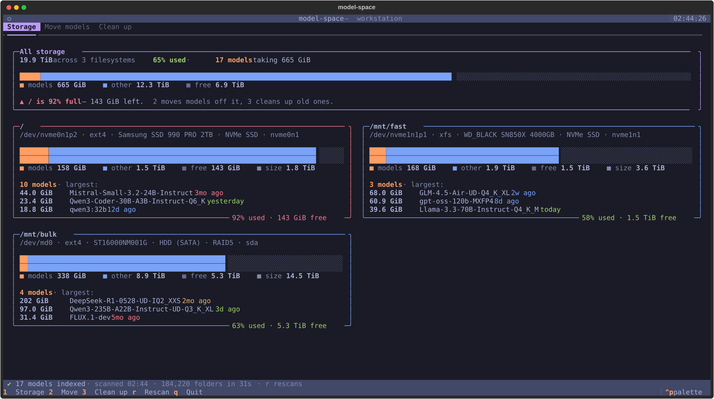
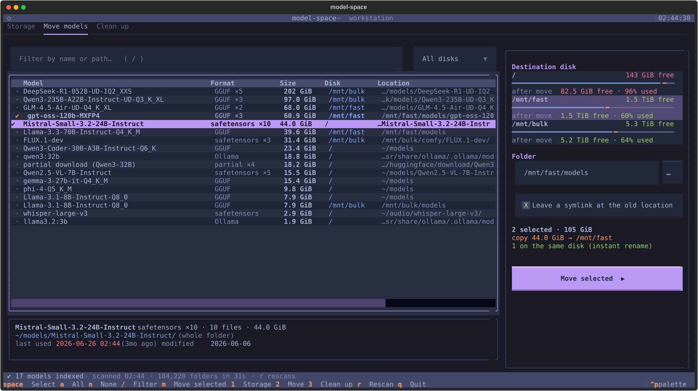
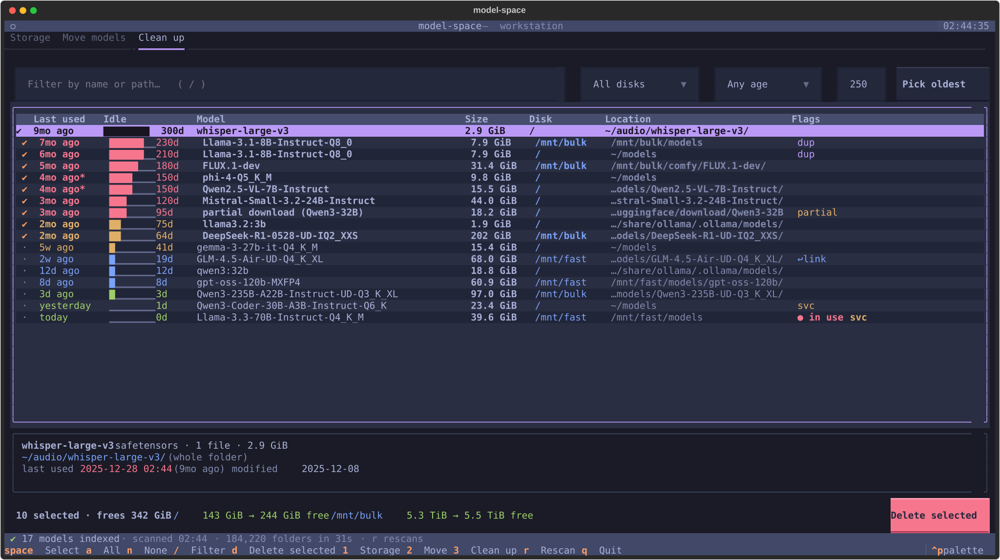

# model-space

A terminal UI for people with too many local LLM weights and not enough disk.

It shows used and free space on every filesystem (and how much of it is models),
lets you move models between disks safely, and helps you delete the ones you
haven't used for the longest.



## Features

**1 · Storage** — a card per filesystem with a stacked *models / other / free* bar,
the device behind it (NVMe, HDD, LVM, RAID), the largest models on it, and a
warning for any disk over 90% full. Updates live while you work.

**2 · Move models** — filter, select with `space`, pick a destination disk (each shows
its free space *after* the move, or "won't fit") and a folder, press `m`.



- Same filesystem → instant rename.
- Different filesystem → copied with progress, speed and ETA; verified; only then are
  the originals removed. Cancel at any time and the originals are untouched.
- Copies bypass the page cache, so a model you're currently serving doesn't get evicted.
- By default a symlink is left at the old location, so systemd units and start scripts
  that point at the old path keep working. Existing symlinks to the model are retargeted.
- File times are preserved, so "last used" history survives the move.

**3 · Clean up** — every model sorted by how long since it was last used, with an
idle bar, age filter and per-disk filter. Type a size and press **Pick oldest** to
select the longest-unused models until that much space would be freed.



### What it understands

- GGUF (including multi-part `-00001-of-00005` shards), safetensors, PyTorch `.bin/.pt/.pth`,
  `.ckpt`, ONNX, llamafile, and partial/abandoned downloads (`.incomplete`, `.part` …)
- Model folders (HF-style repos, quant folders with an `mmproj`, ComfyUI-style bundles)
  are treated as one unit, so they move and delete together
- The Hugging Face hub cache (`models--org--name`)
- Ollama stores — models are listed by tag; deleting removes the manifest and any
  blobs no other tag uses (or calls `ollama rm` when the store isn't writable)

### Flags

| Flag | Meaning |
|---|---|
| `● in use` | a process has the model open or mmapped — it will never be moved or deleted |
| `svc` | a systemd unit (or the script it runs) refers to it; **Pick oldest** skips these |
| `dup` | another copy with the same name and size exists elsewhere |
| `↩link` | a symlink elsewhere points at it (removed with it, retargeted when it moves) |
| `ro` | you don't have permission to change it |
| `*` after a date | several models were read at the same moment (a backup, Ollama's startup scan), so the real last use was *no later* than shown |

## Install

Linux only. Needs Python 3.10+ and [Textual](https://github.com/Textualize/textual)
(developed against Textual 8.2).

```sh
pip install --user textual           # or: pipx/uv, or your distro's package
curl -LO https://raw.githubusercontent.com/DingoOz/model-space/main/model-space
chmod +x model-space && mv model-space ~/.local/bin/   # anywhere on your PATH
```

## Usage

```sh
model-space                  # the TUI
model-space --list           # print the model index and exit (no TUI)
model-space --rescan         # ignore the cached index on startup
model-space --min-size 1G    # hide models smaller than this (default 200M)
model-space --root /data     # also scan this folder (repeatable)
```

| Key | Action |
|---|---|
| `1` `2` `3` | Storage / Move / Clean up |
| `space` / `enter` | select row |
| `a` / `n` | select all shown / clear selection |
| `/` | filter |
| `m` | move selected (tab 2) |
| `d` | delete selected (tab 3) |
| `r` | rescan |
| `ctrl+p` | command palette (change theme, etc.) |
| `q` | quit |

Click a column header to sort by it.

## How it works

- **Scanning** walks every real mounted filesystem in parallel (system directories on
  `/` such as `/usr`, `/proc` and `/var` are skipped, as are `.git`, `node_modules`
  and virtualenvs) and only `stat`s files whose names look like weights. A few
  hundred thousand folders take ~30 s; the result is cached in
  `~/.cache/model-space/index.json`, so the next start is instant while a fresh
  scan runs in the background.
- **Last used** is the newest access time (atime) of the model's files. With
  `relatime` (the default on most distros) atime is bumped at most once a day when a
  file is read or mmapped, so it's accurate to about a day — but anything else that
  reads the file (backups, checksums, indexers) counts as use too. `noatime` mounts
  make this column meaningless.
- **In use** comes from `/proc/*/fd` and `/proc/*/maps` of processes you can see.
  It's rechecked right before every move or delete.
- **svc** is a text match of the model's path or file name against
  `/etc/systemd/system/*.service`, `~/.config/systemd/user/*.service` and the scripts
  and environment files their `ExecStart=` lines run. Models referenced only from a
  config file elsewhere won't be flagged.

Settings (theme, last destination folder per disk) live in
`~/.config/model-space/config.json`.

## License

[Apache License 2.0](LICENSE)
